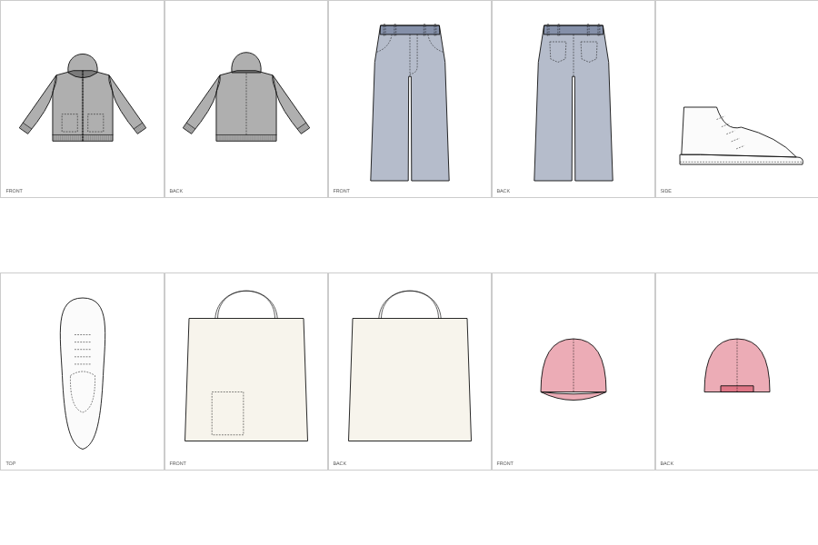

# FashionDesigner

写真や絵から、着ている服・靴・カバン・小物を分解し、平面図（フラットスケッチ）と仕様書（素材・パーツ・寸法・縫製手順）に起こすツール。依頼文から新しいデザインを起こすこともできます。



## 主な機能
- 画像 1 枚から着用アイテムを個別に分解（decompose）
- アイテムごとの前後平面図を SVG で出力（靴は側面と上面）
- 素材・パーツ表（BOM）・推定寸法・縫製手順をまとめた仕様書 HTML
- 依頼文から新規デザイン（design）
- JSON を手で直して再描画（render）
- Atelier / CharacterDesigner と JSON で連携（docs/integration.md）

## 動作環境
- Node.js 22 以上
- 分解・デザインには Anthropic API の認証情報

## セットアップ
1. `npm install`
2. `export ANTHROPIC_API_KEY=your-api-key-here`（render だけなら不要）
3. `npm run build`

## 使い方
```bash
npm run cli -- decompose photo.jpg --out out/look1
npm run cli -- design "SF風の作業用ジャケット。赤とオレンジ" --out out/new
npm run cli -- render fixtures/street-outfit.spec.json --out out/sample
```
出力: `spec.json`、`<id>-front.svg` / `<id>-back.svg`、`techpack.html`

## 設定
| 名前 | 用途 | 必須 |
|---|---|---|
| ANTHROPIC_API_KEY | Claude API の認証 | decompose / design のとき必須 |
| FASHION_MODEL | 解析に使うモデル（既定 claude-opus-5-5） | 任意 |

## ディレクトリ構成
- `src/schema.ts` 受け渡し形式（GarmentSpec）
- `src/analyze.ts` 画像・依頼文の解析
- `src/render/` 平面図と仕様書の描画
- `fixtures/` サンプル JSON
- `docs/` 決定記録・連携仕様・画像

## 開発者向け
```bash
npm run typecheck
npm test
```
平面図のテストは全テンプレートの全選択肢を描画し、NaN やキャンバス外へのはみ出しを検出します。

## ライセンス
未定（UNLICENSED）

## AtelIer の拡張として使う

AtelIer の拡張としても使えます。PowerShell で次を実行すると、拡張の置き場（`C:\ProgramData\AtelIer\extensions\FashionDesigner\`）へ入ります。

```powershell
.\atelier_extension\install.ps1
```

AtelIer を起動すると「ファッションデザイン」のメニューが出て、輪郭の形（長方形・円・三角形・L字）と幅・高さ・厚みを選ぶダイアログで、立体メッシュの投影プレビューを見ながら OBJ / GLB で保存できます。生成は `mesh_core.py` をそのまま使います。
