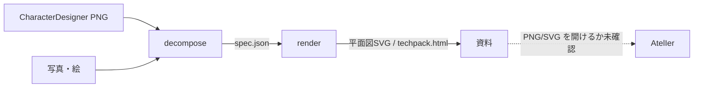

# AtelIer・CharacterDesigner・FashionDesigner・3DDesignerの連携仕様

## 役割

| アプリ | 担当 | 現在確認できる入出力/機能 |
| --- | --- | --- |
| AtelIer | 絵を描く・直すホストアプリ | PNG/PSDの読込・書出し。CharacterDesigner拡張の実行先 |
| CharacterDesigner | 人物の設定資料・三面図と人物3D | 三面図生成、PNG/PSD書出し。1枚絵/三面図から骨付きVRM 1.0/GLBを作る `tools/engine/chara3d.py` もある |
| FashionDesigner | 服画像から輪郭・図面/形状JSONを作る | PNG読込、輪郭編集、SVG/JSON出力、ローカルAPI経由のOBJ/GLB押し出し |
| 3DDesigner | 形状JSONをメッシュへ変換する | FashionDesignerの `fashiondesigner.shape.v2` JSONを読込み、OBJ/GLB出力 |

## 現在動く範囲

FashionDesignerと3DDesignerには、単一の2D輪郭を閉じた三角メッシュへ押し出すローカル処理があります。FashionDesigner StudioではJSON/OBJ/GLBを出し、3DDesignerの画面ではそのJSONを読み込んでOBJ/GLBを出力します。両方のメッシュコアで6件の単体テストが通り、HTTP APIのOBJ/GLB応答もローカルで確認しました。

これは輪郭から厚みを持つ形を作る処理で、服の前身頃・後身頃・袖などを分けて縫い合わせたり、人物に着せたりする機能ではありません。現状の3D出力を完成した衣服モデルとして扱いません。

## 統合テスト（未実行）
- CharacterDesignerで実生成したPNGをFashionDesignerに読み込む。
- FashionDesignerの抽出→SVG/JSON/OBJ出力を検証する。
- JSONの再読み込みで輪郭が維持されるか検証する。
- AtelIerが実際に対応する形式を確認し、往復編集でデータ欠落がないか検証する。

## 第3段階：アイテム分解の受け渡し（GarmentSpec、実装済み・連携先は未対応）
画像から服・靴・カバン・小物を分解した結果を `fashion-designer/garment-spec@1`（定義: `src/schema.ts`）の JSON で出力する。
Studio の輪郭データ（形）に対し、こちらは「何のアイテムか・素材・パーツ・縫製手順」を持つ。第2段階の `pieces` / `measurements` の中身の候補とする。

- CharacterDesigner -> FashionDesigner: 保存した PNG を `npm run cli -- decompose <png>` に渡す。キャラ ID は `--hint` で渡す
- 手修正: `spec.json` を編集して `render` で平面図と仕様書を作り直す
- AtelIer: 読み込める形式が未確認のため、spec.json を直接読めるとは主張しない
- 互換性: 項目追加は版を変えない。削除・意味変更は `@2` に上げる。読み手は知らない項目を無視する

## まだ接続していない範囲

- CharacterDesignerの骨付き人物GLBを3DDesignerへ読み込み、FashionDesignerの服を同じ座標・尺度で合わせる。
- FashionDesignerで画像から複数の衣服パネルを認識し、縫い目・縫い代・寸法を保持する。
- 服パネルを3D上で配置・縫合し、人物の体型に合わせ、貫通や隙間を確認する。
- AtelIerで修正した絵を差分確認付きでFashionDesignerへ戻し、元画像/編集レイヤー/形状を対応付ける。
- CharacterDesigner・AtelIerと直接通信するAPIやプラグイン。現時点ではPNG/PSD/JSON/GLB等のファイル交換を基準にする。

## 形状データと単位

現行FashionDesigner形状JSON `fashiondesigner.shape.v2` は `unit: "mm"` と単一の `points` 輪郭を持ちます。3DDesignerは点列と正の押し出し厚みを受け取ります。複数パネル、穴、縫合線、衣服部位、人物への配置変換はまだ表現しません。

次の共通形式では、元画像と座標変換、人物ビュー、採寸根拠、複数の `pieces`、閉輪郭/穴、各パネルの縫合辺、縫い代、材料/厚み、生成履歴を保持します。写真から実寸を特定できない場合は尺度未確定として表示し、製造用型紙と称しません。

## 次の統合試験

1. CharacterDesignerまたはAtelIerから人物/服の実画像をPNGで書き出し、FashionDesignerへ読み込む。
2. FashionDesignerの輪郭抽出とJSON保存を実行し、再読込で点列・単位・画像座標が保たれることを確認する。
3. 同じ実JSONを3DDesignerに読み込み、OBJ/GLBを出力する。Blender等で再読込して軸・尺度・法線・見た目を確かめる。
4. CharacterDesigner出力の人物GLBを読み込み、人物と服の座標系/尺度が一致するかを試す。この機能は未実装のため、まずインポートとビューアを追加する。
5. パネル/縫合の共通形式を決めてから衣服メッシュを実装し、前後・側面表示、重大な貫通/隙間、寸法差を評価する。
6. AtelIerで編集したPNG/PSDを再取り込みし、元絵との対応と抽出輪郭の差分を確認する。
