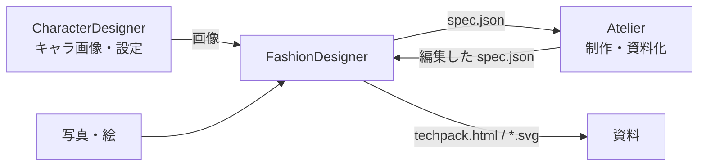

# 連携仕様（Atelier / CharacterDesigner）

受け渡しは GarmentSpec JSON 1 種のみ。定義は `src/schema.ts`。



## 方向ごとの使い方
- CharacterDesigner -> FashionDesigner: キャラクター画像を `decompose` に渡す。キャラ ID は `--hint` で渡す
- FashionDesigner -> Atelier: `spec.json` を渡す。Atelier 側は `schema` 値で版を確認してから読む
- Atelier -> FashionDesigner: 編集後の JSON を `render` に渡すと平面図と仕様書を作り直す

## ライブラリとして使う
```ts
import { analyzeImage } from "fashion-designer/dist/analyze.js";
import { renderFlatSvg } from "fashion-designer/dist/render/flat.js";
```

## 互換性
- 項目追加は版を変えない。項目の削除・意味変更は `@2` に上げる
- 読み手は知らない項目を無視すること
